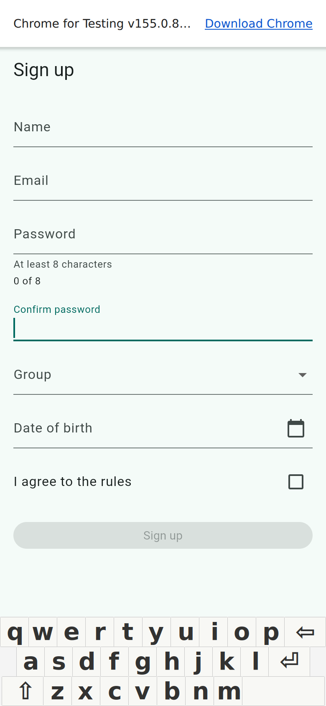
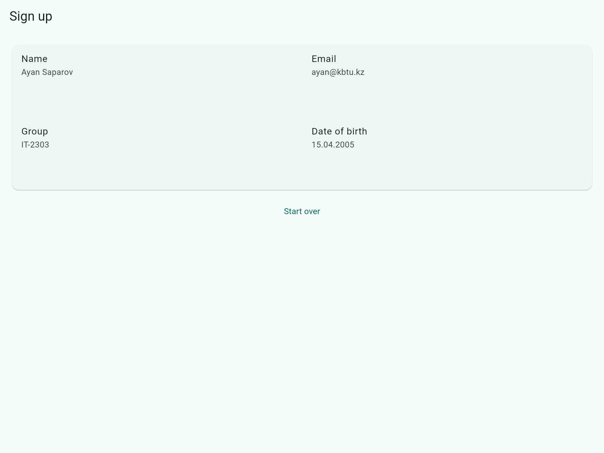

# Practice 7 A Form That Validates Itself

A Flutter sign-up form with field validation, keyboard navigation, group selection and a date picker. After a valid submission, the entered details appear in a summary card. The card switches to two columns when its own width reaches 600 pixels.

## Run

Checked with Flutter 3.47 and Dart 3.13.

```bash
flutter pub get
flutter run
```

To run the web version:

```bash
flutter run -d chrome
```

## Check

```bash
dart format .
flutter analyze
flutter test
```

## Files

- `lib/main.dart` — form, validation, focus, date picker and state.
- `lib/summary_card.dart` — responsive summary card.
- `test/signup_form_test.dart` — form and layout tests.

Sign up is enabled after agreeing to the rules. Start over clears the form and restores its initial state. The entered data is kept in memory.

## Screenshots




