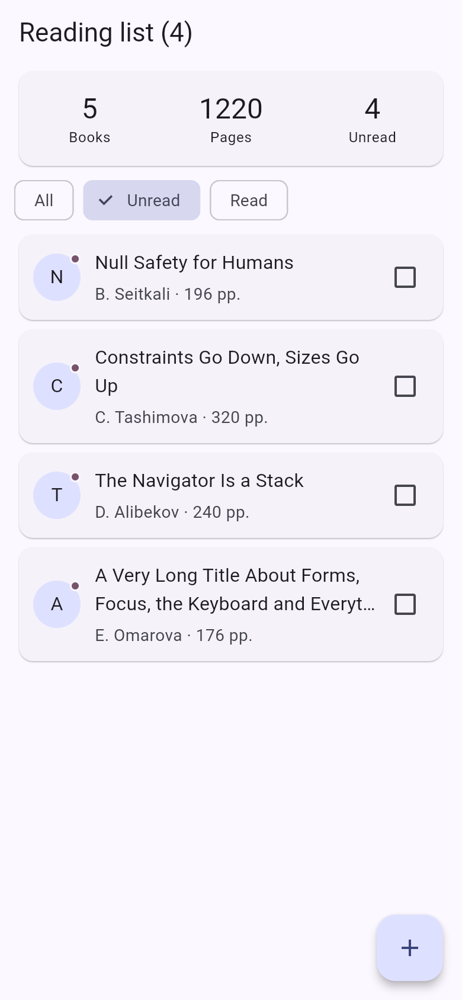
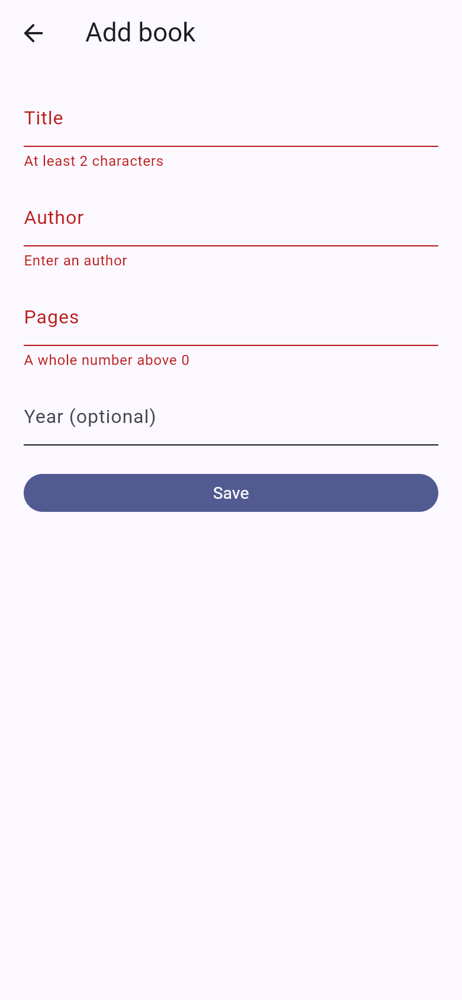

# Practice 8 A Little of Everything

A Flutter reading list app. Books can be filtered by read status, marked as read or unread, added through a form and deleted after confirmation.

## Run

```bash
flutter pub get
flutter run
```

The project includes Android and web support. To run it in Chrome:

```bash
flutter run -d chrome
```

## Check

```bash
dart format .
flutter analyze
flutter test
```

## Source files

- `lib/main.dart` — app entry point and theme.
- `lib/models/book.dart` — Book, seed data and collection functions.
- `lib/widgets/book_tile.dart` — reusable book card.
- `lib/library_screen.dart` — list, filters and totals.
- `lib/detail_screen.dart` — book details and actions.
- `lib/add_book_screen.dart` — form and validation.

Books are kept in memory. Restarting the app restores the initial list.

## Screenshots




